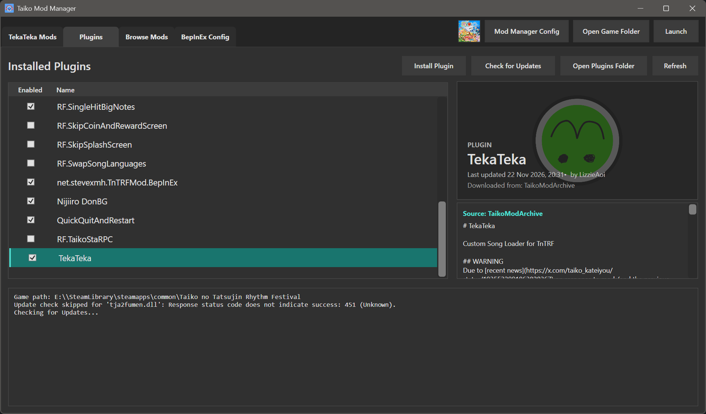

# Taiko Mod Manager

Taiko Mod Manager is a tool designed to enhance your experience with the Steam Release of *Taiko no Tatsujin: Rhythm Festival*. It provides features for managing mods, plugins, and configurations, with integration for BepInEx.

## Features

- **Auto-Detection**: Automatically detects the game installation path.
- **Plugin Management**: Install and update directly from GitHub repositories as well as directly manage plugins configuration.
- **Mod Management**: Enable, disable, and configure mods through a user-friendly interface.
- **BepInEx Integration**: Automatically installs BepInEx if not present and manages its configuration.
- **Taiko Mod Archive Browser**: Browse, search, download, and install Rhythm Festival PC plugins and song mods from Taiko Mod Archive without leaving the manager.
- **Cached Archive Details**: Locally caches Taiko Mod Archive metadata and preview images, and checks archive installs for updates using their post IDs and last-updated timestamps.
- **TekaTeka Support**: Includes functionality for managing TekaTeka mods.
- **Manager Settings**: Change the game folder, optionally add a GitHub API key, and choose whether Launch uses Steam or starts the game executable directly.
- **GitHub Release Checks**: Compares the running build's commit with the latest GitHub release and can open its release page when a newer build is available.

## Requirements

### Prerequisites

1. **Operating System**: Windows 10 or Windows 11.
2. **.NET Framework**: .NET 8.0 or higher. You can download it from [Microsoft's .NET page](https://dotnet.microsoft.com/).
3. **BepInEx**: The tool will auto-install BepInEx if it's not already set up.
4. **Game Installation**: Ensure *Taiko no Tatsujin: Rhythm Festival* is installed on your system through Steam.

### Additional Dependencies

- `Tomlyn`: For parsing and managing TOML files.
- `System.IO.Compression`: For handling ZIP files when installing plugins.

## Installation

1. Clone or download this repository to your local machine.
2. Ensure all prerequisites are installed.
3. Build the project using Visual Studio or another compatible IDE.

## Usage

1. Launch the application.
2. Follow the on-screen instructions to locate the game executable (`Taiko no Tatsujin Rhythm Festival.exe`).
3. Use the tabs to manage:
   - **Plugins**: Install, update, and configure plugins.
   - **TekaTeka Mods**: Manage TekaTeka song mods and their configurations. If TekaTeka is not installed, accept the prompt to install it from Taiko Mod Archive, then launch the game once to create `TekaSongs`.
   - **Browse Mods**: Find and install Rhythm Festival PC plugins or song mods from Taiko Mod Archive.
   - **BepInEx Config**: Edit BepInEx settings.
4. Enjoy a customized *Taiko no Tatsujin* experience!

## How It Works

### Game Path Detection

The application attempts to locate the game automatically by checking Steam library folders or prompts the user to manually select the game executable.

### Plugins

- Download and install plugins from GitHub repositories.
- Automatically check for updates.
- Edit plugin configurations.

### Mods

- Manage mods stored in the `TekaSongs` folder.
- Enable or disable mods via their `config.toml` files.

### Configuration

- View and edit `BepInEx.cfg` through an intuitive UI.
- Edit plugin and song-mod configuration files using type-aware controls for sections, comments, checkboxes, and text settings.
- Open **Mod Manager Config** to change the game location, launch type, or GitHub API key.

### Updates

- Builds are identified by the Git commit they were produced from.
- The manager checks GitHub Releases for a newer build and opens the release page on request; it does not replace its own files automatically.
- GitHub Actions creates a new commit-tagged `latest` release for every push to the `rewrite` branch.

## Contributing

Contributions are welcome! Feel free to submit issues or pull requests.

## AI disclosure

The `rewrite` and `archive` branch were developed with substantial assistance from OpenAI Codex. AI was used for implementation and UI work; project maintainers remain responsible for reviewing, testing, and shipping the code.

## License

This is free and unencumbered software released into the public domain.

Anyone is free to copy, modify, publish, use, compile, sell, or distribute this software, either in source code form or as a compiled binary, for any purpose, commercial or non-commercial, and by any means.

For more information, please refer to [The Unlicense](http://unlicense.org/).

---
